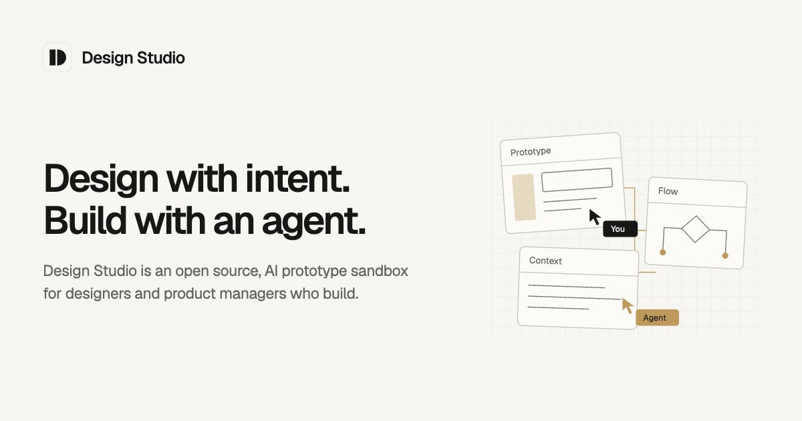

# Design Studio Starter

An open-source, local prototype sandbox for designers and product managers who build with coding agents. Turn ideas into interactive prototypes, keep the thinking behind them close, and shape an environment that fits your team.

**[View demo](https://itspatmorgan.com/design-studio-starter/) · [Install Design Studio](src/platform/context/installing.md)**

## What you can do

- **Connect the whole idea.** Keep working prototypes, diagrams, canvases, and documents together as you explore and refine a flow.
- **Give your agent a foundation.** Bring together your components, theme, product context, and instructions so prototypes reflect your team's design system.
- **Make it yours.** Start with included examples, customize the studio, and own the code and everything you create. Work individually or with a team.

## Get started

Install Design Studio in a folder on your computer, then open that folder in your preferred agent harness. Use an agent that can read files and run commands to configure your studio and build prototypes.

Follow the [installation guide](src/platform/context/installing.md). It gives you one set of steps to run yourself or ask your agent to carry out.

Once you have opened your studio folder, ask:

> Read AGENTS.md and help me configure my Design Studio. Start with the included examples and show me the running preview.

## Share your work

Design Studio builds a static website you can publish with hosting services such as [Vercel](https://vercel.com/docs/frameworks/frontend/vite), [Netlify](https://docs.netlify.com/build/configure-builds/javascript-spas/), and GitHub Pages. When you are ready, ask your agent:

> Help me publish my Design Studio with [hosting service] so [audience] can explore it. Follow my studio's publishing instructions and guide me through setting up hosting. Review what will be shared and verify the published link.

Your agent can help you choose a host if you do not have one in mind. You keep editing in your local studio; publish again to share updates. See [Publishing](src/platform/context/publishing.md) for technical requirements and access controls.

## Explore further

Design Studio is in early beta. Explore the examples, then ask your agent to help build your first prototype.

- [Manual](src/platform/modules/documentation/pages/index.md) — using and customizing your studio.
- [Modules](src/platform/context/modules.md) — extending its capabilities.
- [Contributing](CONTRIBUTING.md) — feedback, issues, and pull requests.
- [Changelog](CHANGELOG.md) — what's changed.

Created by **[Patrick Morgan](https://itspatmorgan.com)**. Follow the thinking behind the work at [Unknown Arts](https://www.unknownarts.com/).

## License

[MIT](LICENSE). Includes [Flexoki](https://stephango.com/flexoki) by Steph Ango (MIT) and [Pragmatic drag and drop](https://atlassian.design/components/pragmatic-drag-and-drop/) by Atlassian (Apache-2.0).
