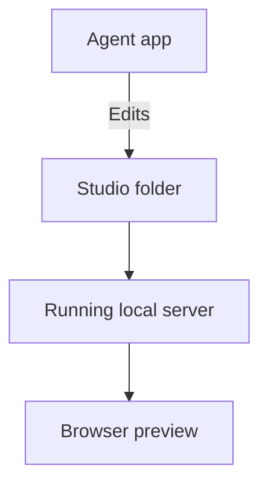

## How do I set it up?

If you are reading this in your local studio, it is already running. For a new installation, follow the [installation guide](/documentation/context/platform.core/context/installing). It provides one set of steps you or your agent can carry out.

Install Studio in a folder on your computer, then open that folder in your preferred coding tool. Use an agent that can read files and run commands. Ask:

> Read AGENTS.md and help me configure my Design Studio. Start with the included examples and show me the running preview.

Your agent uses the repository's instructions to register you and configure Studio. You can explore the examples before making those choices.

## What needs to be open?

Your **agent app** changes files in your **studio folder**. A local server reads those files and provides the **browser preview** where you explore the result.

Continue agent work in the studio folder shown during setup. Opening its browser address alone does not select that folder in your agent app.

Keep the local server running while using Studio. Closing a browser tab does not delete your work. If the server stops, ask your agent to reopen the studio.

## How do I return later?

Open the same studio folder in your agent harness and ask:

> Open my Design Studio and show me the running preview.

If you cannot find it, ask the agent to locate your existing studio before creating another one. Your files remain in that folder between sessions.

To take a newer Studio release, see [updating a customized studio](/documentation/manual/customize#how-do-i-update-my-studio).

## How do I join a team studio?

Ask a teammate for access to the team's repository, then ask your agent to open a local copy and register you as a contributor. Keep the team's existing systems and settings.

Joining uses the existing studio; creating a new studio gives you a separate environment. See [Personal & team use](/documentation/manual/team) for permissions and sharing changes.

## What if I am viewing an online studio?

A published studio lets you explore interactive work without running the project locally. Creating and editing happen in a local working copy. See [Publishing & Home](/documentation/manual/share) for the distinction.
